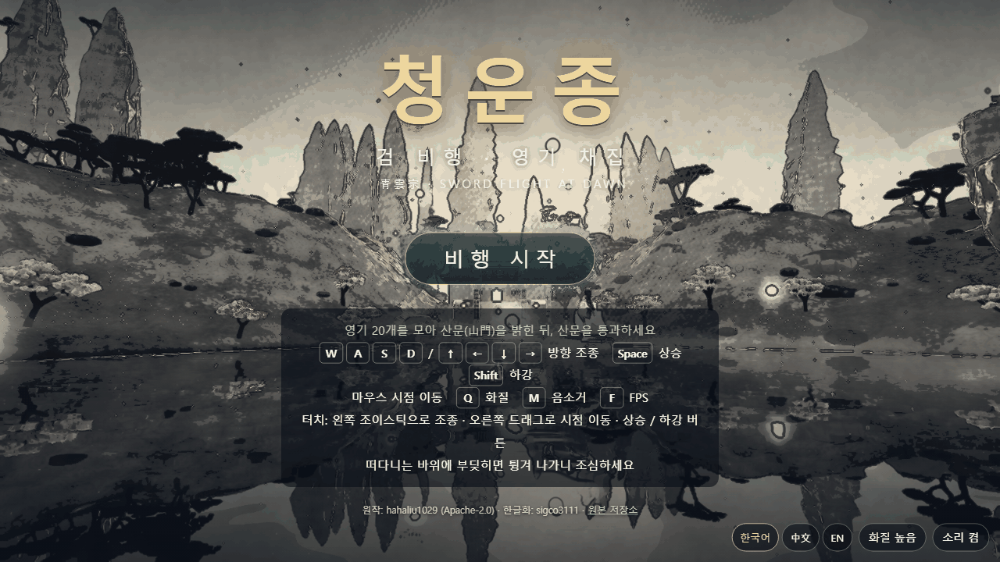
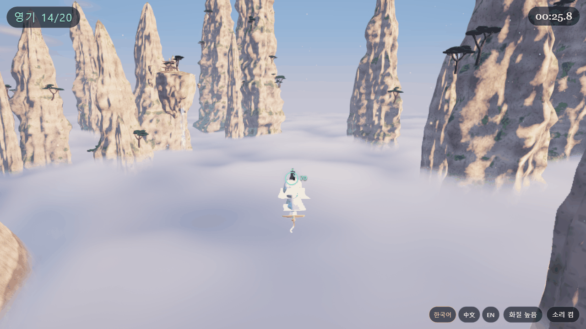
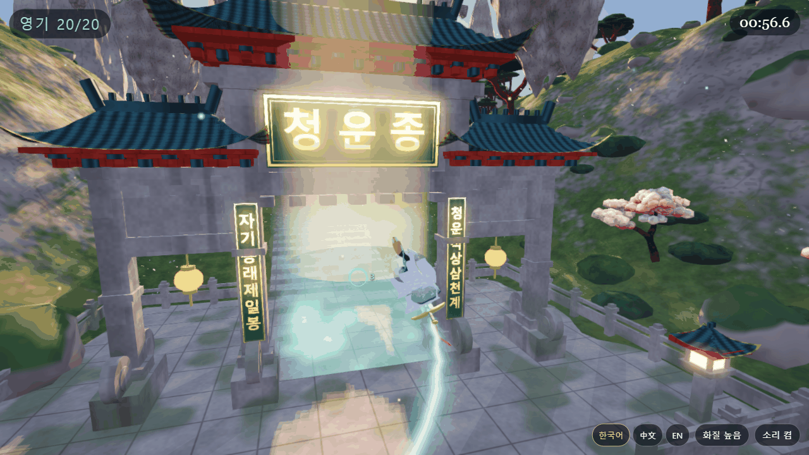
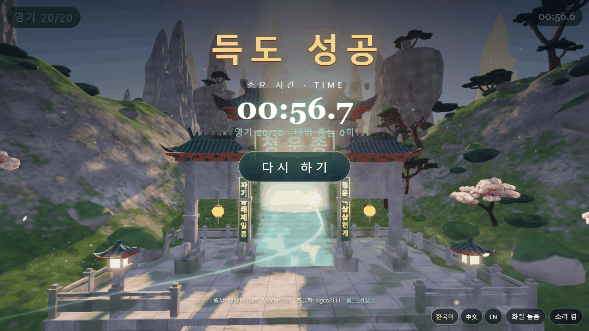

<div align="center">

# 청운종 검 비행 — 한글화 버전

**검을 타고 새벽의 선문(仙門) 산속을 날며 영기 20개를 모으는 3D 웹 게임**

[](https://sigco3111.github.io/qingyun-sword-flight-ko/)
[](LICENSE)

**https://sigco3111.github.io/qingyun-sword-flight-ko/**

</div>

---

## 프로젝트 소개

**청운종(青雲宗) · 검 비행 영기 채집**(원제: 青云宗 · 御剑采灵 / *Qingyun Sect: Sword Flight*)은 검을 타고 산봉우리와 구름바다 위를 날며 떠 있는 영기(靈氣) 20개를 모은 뒤, 열린 산문(山門)을 통과하면 "득도"하는 짧은 3D 웹 게임입니다. 원작은 hahaliu1029가 만든 게임이고, 이 저장소는 그 게임을 **한국어로 옮긴 한글화 버전**입니다.

- **무엇을**: 원작의 화면 문구·조작 안내·알림·3D 현판 글자까지 한국어로 번역하고, 한국어/中文/EN 언어 전환 기능을 더했습니다. 게임플레이 코드는 바꾸지 않았습니다.
- **왜**: 원작 UI는 중국어와 영어 병기라서, 한국어 사용자도 조작법과 목표를 바로 이해하고 즐길 수 있도록 하기 위해서입니다.
- **누구를 위해**: 설치 없이 브라우저에서 한 판 가볍게 즐기고 싶은 분, 그리고 three.js로 만든 단일 파일 3D 웹 게임을 살펴보고 싶은 분.

## 주요 기능

- **검 비행 3D 게임**: 영기 20개를 모으면 산문이 열리고, 산문을 통과하면 완료됩니다. 완료 화면에 소요 시간, 모은 영기 수, 바위 충돌 횟수가 표시됩니다.
- **HUD**: 왼쪽 위에 영기 개수(`영기 0/20`), 오른쪽 위에 타이머, 화면 위 알림 문구, 그리고 가장 가까운 목표(영기 또는 산문)의 방향과 거리를 가리키는 표시가 나옵니다.
- **장애물**: 떠다니는 바위에 부딪히면 튕겨 나가며, 충돌 횟수는 완료 화면에 기록됩니다.
- **키보드·마우스·터치 지원**: 데스크톱은 키보드와 마우스, 터치 기기는 가상 조이스틱과 상승/하강 버튼이 나타납니다.
- **화질 높음/낮음 전환**: `Q` 키 또는 화면 오른쪽 아래 버튼. 프레임이 낮게 유지되면 게임이 스스로 낮은 화질로 바꾸고 알려 줍니다.
- **소리 켬/끔**: `M` 키 또는 버튼. 효과음은 음원 파일 없이 Web Audio로 합성합니다.
- **FPS 표시**: `F` 키.
- **언어 전환**: 화면 오른쪽 아래 `한국어` / `中文` / `EN` 버튼.

### 조작법

| 입력 | 동작 |
|---|---|
| `W` `A` `S` `D` / 방향키 | 방향 조종 (W/S 가속·감속, A/D 선회) |
| `Space` | 상승 |
| `Shift` | 하강 |
| 마우스 | 시점 이동 (화면 클릭으로 마우스 고정, `Esc`로 해제 / 버튼을 누른 채 끌어도 이동) |
| `Q` | 화질 높음/낮음 전환 |
| `M` | 소리 켜기/끄기 |
| `F` | FPS 표시 |
| `Enter` | 시작 / 다시 하기 |
| 터치 | 왼쪽 조이스틱으로 조종, 오른쪽 드래그로 시점 이동, 상/하 버튼으로 상승·하강 |

### 한글화 내용

- **번역한 것**: 제목·부제, 시작/다시 하기 버튼, 목표와 조작 안내, HUD 문구(`영기 n/20`), 알림 메시지, 화질·소리 버튼과 툴팁, 완료 화면(`득도 성공`, `소요 시간`, `바위 충돌 n회`), 하단 출처 표기, 페이지 제목, 그리고 3D 산문 현판 `청운종`과 양쪽 대련 `자기동래제일봉` · `청운직상삼천계`.
- **언어 전환**: `한국어` / `中文` / `EN` 버튼으로 바꿀 수 있고 선택은 브라우저(`localStorage`)에 저장됩니다. `中文`은 원작의 중국어·영어 병기 문구 그대로입니다.
- **기본 언어 규칙** (우선순위 순): ① 주소의 `?lang=ko|zh|en` → ② 이전에 저장된 선택 → ③ 브라우저 언어가 한국어(`ko`)이면 한국어 → ④ 그 외에는 `中文`.

## 실행 화면

실제 배포 주소에서 1280×720 데스크톱 화면으로 직접 캡처한 이미지입니다.

<table>
  <tr>
    <td align="center" width="50%">
      <br>
      <sub><b>1. 제목 화면</b> — 한국어 안내와 오른쪽 아래 언어 전환(한국어/中文/EN)</sub>
    </td>
    <td align="center" width="50%">
      <br>
      <sub><b>2. 비행 중</b> — 영기 개수·타이머 HUD와 구름바다 위의 봉우리</sub>
    </td>
  </tr>
  <tr>
    <td align="center" width="50%">
      <br>
      <sub><b>3. 산문(山門)</b> — 한글 현판 <code>청운종</code>과 대련</sub>
    </td>
    <td align="center" width="50%">
      <br>
      <sub><b>4. 완료 화면</b> — 득도 성공, 소요 시간, 영기 수, 바위 충돌 횟수</sub>
    </td>
  </tr>
</table>

## 설치·실행 방법

### 온라인에서 바로 플레이

설치할 것이 없습니다. **https://sigco3111.github.io/qingyun-sword-flight-ko/** 에 접속해 `비행 시작`을 누르거나 `Enter`를 누르세요.

- 브라우저가 **WebGL2**를 지원해야 합니다.
- 소리는 `비행 시작` 이후부터 재생됩니다. 필요하면 `M` 키로 끌 수 있습니다.
- 특정 언어로 열려면 주소 끝에 `?lang=ko`, `?lang=zh`, `?lang=en`을 붙입니다. 화질은 `?q=high` 또는 `?q=low`로 지정할 수 있습니다.

### 내 컴퓨터에서 실행

게임 전체가 `index.html` 하나이고, 코드 안에서 외부 파일이나 외부 서버를 불러오지 않습니다(원본 저장소로 가는 링크 제외). 저장소를 받아 정적 서버로 열면 됩니다.

```bash
git clone https://github.com/sigco3111/qingyun-sword-flight-ko.git
cd qingyun-sword-flight-ko
python3 -m http.server 8000
# 브라우저에서 http://localhost:8000/ 접속
```

별도의 빌드나 패키지 설치 과정은 없습니다. 이 저장소에는 빌드 도구가 없고, 번들된 결과물인 `index.html`이 그대로 배포됩니다.

## 기술 내용

| 항목 | 내용 |
|---|---|
| 구성 | 단일 자체 완결형 `index.html` (약 2.2 MB / 2,310,033 바이트). 별도 에셋 파일 없음 |
| 3D 엔진 | [three.js](https://threejs.org/) r170 (MIT), 번들·압축된 형태로 `index.html`에 포함 |
| 렌더링 | WebGL2 (`<canvas>` 하나에 전체 장면 렌더링). 구름, 수면 반사, 빛줄기, 블룸, 그림자, 안티앨리어싱 등을 화질 프리셋에 따라 조절 |
| 3D 모델 | GLB 모델 데이터가 Base64 텍스트로 `index.html`에 내장 |
| 소리 | Web Audio API로 효과음을 코드에서 합성 (오디오 파일 없음) |
| 입력 | 키보드, 마우스(Pointer Lock), 터치(조이스틱·버튼·드래그) |
| 화질 프리셋 | `high` / `low` 두 가지. 선택은 `localStorage`의 `qy-quality`에 저장, `?q=` 주소 매개변수로 덮어쓰기 가능 |
| 언어 | `ko` / `zh` / `en`. 선택은 `localStorage`의 `qy-lang`에 저장, `?lang=` 주소 매개변수로 덮어쓰기 가능 |
| 한글 글꼴 | `Noto Sans KR`, `Malgun Gothic`, `Apple SD Gothic Neo` 등 시스템 글꼴 목록 사용 (글꼴 파일은 포함하지 않음) |
| 배포 | GitHub Pages |

## 라이선스·원작 표기

이 저장소는 **Apache License 2.0** 으로 배포되는 원작을 바탕으로 한 한글화 파생물입니다. 라이선스 전문은 [LICENSE](LICENSE)에 변경 없이 포함되어 있습니다.

### 고지 (NOTICE)

- 원작: **hahaliu1029** — 저장소 https://github.com/hahaliu1029/fable5.2demo (`game/` 폴더, 커밋 `d4ba584e8e680f8d319b666ca6a488637ab88422` 기준). 원작 게임은 Claude Fable 5.2 모델로 제작되었습니다.
- 라이선스: **Apache License 2.0** — 원문은 [LICENSE](LICENSE)에 변경 없이 포함되어 있습니다.
- 한글화: **sigco3111**
- 이 저장소의 `index.html`은 원작 `game/index.html`(빌드 결과물)을 수정한 것이며, 변경 사항은 다음과 같습니다.
  1. 한국어 번역 추가 (화면 문구, 도움말, 알림 메시지, 버튼 설명, 3D 현판·대련 글자 `청운종` 등)
  2. 언어 전환 기능 추가 (한국어 / 中文 / EN), 브라우저 언어가 `ko`이면 한국어를 기본으로 사용
  3. 한글 표시용 글꼴 목록 추가 (`Noto Sans KR`, `Malgun Gothic`, `Apple SD Gothic Neo`)
  4. 제목·완료 화면에 한국어 출처 표기(푸터) 추가

  게임플레이 코드는 변경하지 않았습니다.
- 번들된 [three.js](https://threejs.org/) (MIT License)의 저작권 고지는 `index.html` 안에 그대로 유지됩니다.

원작에 대한 문의와 원본 소스는 원 저장소를 이용해 주세요.
